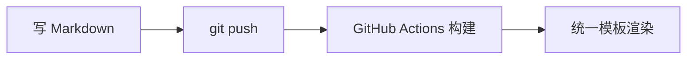

开头第一段：没写 `excerpt` 时，首页列表会用这一段当摘要。上面的标题区（眉标、副标题、导语、键值信息、数据条）全部来自 front matter，正文里不用再写标题。

## 段落与强调

普通段落、**加粗**、*斜体*、`行内代码`、<kbd>⌘</kbd> + <kbd>K</kbd>、<mark>高亮</mark>、[链接](https://github.com/Dynmi) 都照常写。

这一段用了「导语」样式：在段落下一行写 `{: .lead}`，适合放在小节开头。
{: .lead}

### 三级标题

- 无序列表
- 第二项
  - 嵌套也可以

1. 有序列表
2. 第二项

#### 四级标题是小号大写标签

## 长文分节

很长的报告可以用 `<section>` 把正文分节，每节开头放一个 `.sec-num` 小标，节与节之间自动加分隔线；标题里的 `<span class="sub">` 是第二行小字副标题：

```html
<section markdown="1">
<div class="sec-num">01 · 背景</div>

## 小节标题<span class="sub">English subtitle</span>

正文照常写 Markdown……
</section>
```

## 引用与提示框

> 普通引用块：用 `>` 开头。

<div class="callout" markdown="1">
<div class="ct">要点</div>

提示框：`<div class="callout" markdown="1">`，里面照常写 **Markdown**；`.ct` 是左上角的小标题。
</div>

<div class="callout warn" markdown="1">
<div class="ct">注意</div>

把 `callout` 换成 `callout warn` 就是警示色。
</div>

## 代码

```python
def hello(name: str) -> str:
    """代码块写上语言名就有语法高亮"""
    return f"hello, {name}"
```

## 表格

| 写法 | 效果 | 备注 |
| --- | --- | --- |
| Markdown 表格 | 自动加边框、可横向滚动 | 列多也不会撑破版面 |
| HTML `<table>` | 同上 | 需要合并单元格时用 |

## 图片与图注

<figure>
  <div class="fig-body">
    <svg viewBox="0 0 520 120" role="img" aria-label="三个方框依次相连">
      <rect x="10" y="30" width="140" height="60" rx="8" style="fill:var(--accent-soft);stroke:var(--accent)"/>
      <text x="80" y="66" text-anchor="middle" style="fill:var(--ink);font-size:15px">输入</text>
      <path d="M150 60h40" style="stroke:var(--faint);stroke-width:2"/>
      <rect x="190" y="30" width="140" height="60" rx="8" style="fill:var(--panel);stroke:var(--rule)"/>
      <text x="260" y="66" text-anchor="middle" style="fill:var(--ink);font-size:15px">处理</text>
      <path d="M330 60h40" style="stroke:var(--faint);stroke-width:2"/>
      <rect x="370" y="30" width="140" height="60" rx="8" style="fill:var(--accent)"/>
      <text x="440" y="66" text-anchor="middle" style="fill:var(--panel);font-size:15px">输出</text>
    </svg>
  </div>
  <figcaption><b>图 1</b>　内联 SVG 用 <code>style="fill:var(--accent)"</code> 引用设计变量，深色模式会自动跟着变。普通图片把 <code>.fig-body</code> 换成 <code>&lt;img src="/assets/…"&gt;</code>。</figcaption>
</figure>

## Mermaid



## 公式

front matter 写 `mathjax: true` 后，行内用 $E = mc^2$，独立成行用：

$$
\frac{\partial L}{\partial \theta} = \sum_{i=1}^{n} \nabla_\theta \ell(x_i, y_i)
$$

## 数据条、对比栏与卡片

<div class="stats">
  <div class="stat"><div class="v">14.8<small>T</small></div><div class="l">正文里也能放数据条</div></div>
  <div class="stat"><div class="v">2.8<small>M</small></div><div class="l">GPU 小时</div></div>
  <div class="stat"><div class="v">128<small>K</small></div><div class="l">上下文长度</div></div>
</div>

<div class="duo" markdown="1">
<div markdown="1">
##### 方案 A
- 实现简单
- 吞吐较低
</div>
<div markdown="1">
##### 方案 B
- 吞吐高
- 实现复杂
</div>
</div>

<div class="cards">
  <div class="card"><div class="num">01</div><h5>卡片标题</h5><p>适合并列罗列若干要点。</p><div class="take">→ 一句话结论</div></div>
  <div class="card"><div class="num">02</div><h5>卡片标题</h5><p>窄屏下自动变成单列。</p><div class="take">→ 一句话结论</div></div>
</div>

## 信源标签

front matter 写 `evidence_tags: true` 后，正文里的【官方】【实测】【逆向】【推断】【访谈】【公开报道】会渲染成彩色标签；长一点的说明如【官方：发布会原话，2026-07】显示为小号注释。

<footer>
  <h4>参考文献</h4>
  <ol class="refs">
    <li>文末参考文献：正文最后放一个 <code>&lt;footer&gt;</code>，列表加 <code>class="refs"</code>。</li>
    <li>需要的话再加 <code>&lt;p class="colophon"&gt;</code> 写版本说明。</li>
  </ol>
  <p class="colophon">colophon：写作说明、修订记录。</p>
  <div class="endmark">∎</div>
</footer>
